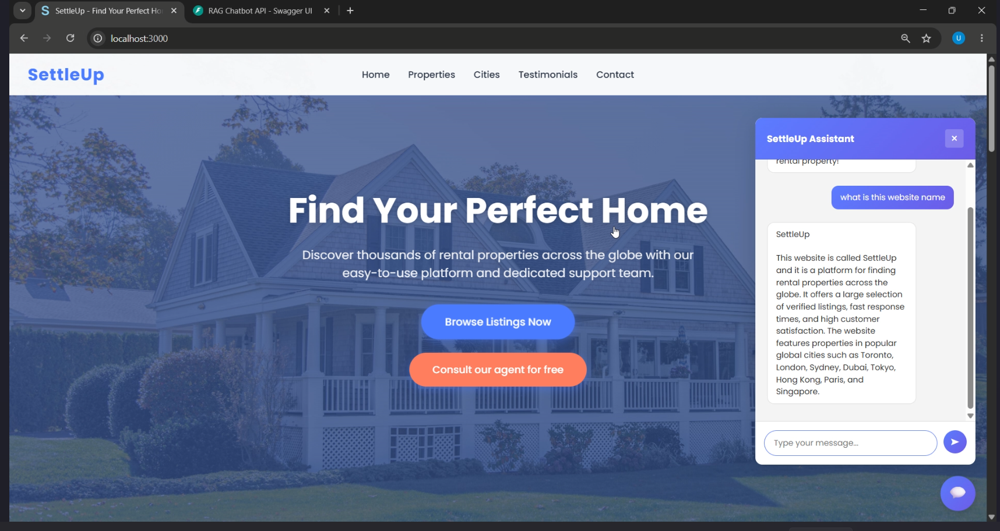

# RAG Chatbot - Website AI Assistant

An AI-powered RAG chatbot system that learns from a website, serves answers through a FastAPI backend, and ships as a single embeddable widget.



one script chat bot is ready

## Project Overview

This project delivers a complete, multi-tenant chatbot experience with two main pieces:

- **Backend API**: Scrapes site content, builds vector embeddings, stores them in a vector database, and generates grounded answers with an LLM.
- **Embeddable widget**: A single UMD JavaScript bundle that renders a Shadow DOM chat UI on any website.

## What It Does

- Trains on a website URL to build a searchable knowledge base
- Answers user questions with retrieved, site-specific context
- Keeps each client isolated with API keys and tenant IDs
- Ships a plug-and-play widget for quick embedding

## Key Capabilities

- Retrieval-augmented generation workflow (ingest → embed → retrieve → answer)
- Multi-tenant data isolation
- Shadow DOM widget to avoid CSS conflicts
- Works across any site that can load a script tag

## Flow

```
Training:
Website URL → Scraper → Chunking → Embeddings → Vector DB

Chat:
User question → Retrieve relevant chunks → LLM answer → Widget response
```

## Technology Stack

- **Backend**: Python, FastAPI
- **LLM**: Google Gemini
- **Vector DB**: ChromaDB
- **Scraping**: BeautifulSoup
- **RAG Orchestration**: LangChain
- **Widget**: UMD JavaScript bundle with Shadow DOM

## Core Components

- `backend/`: FastAPI service, scraping, indexing, and chat logic
- `widget/`: Pre-built UMD bundles for embedding

## Intended Use Cases

- E-commerce support
- Documentation assistants
- Service business FAQs
- Product or portfolio Q&A

